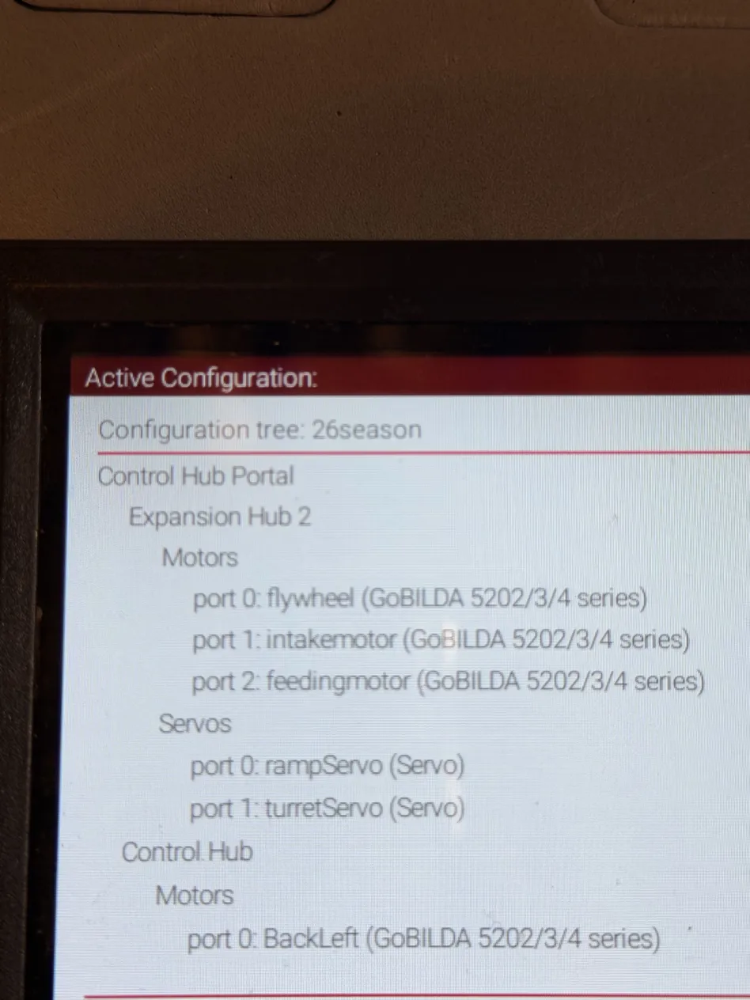
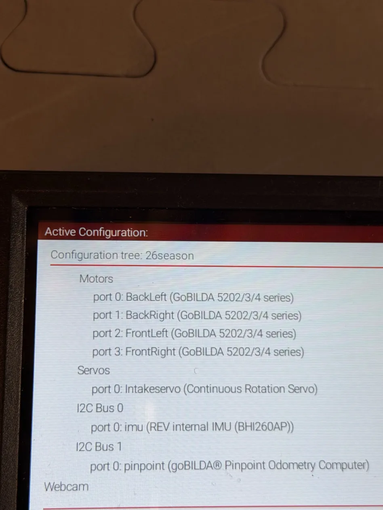

# Hardware config: `26season`

The robot configuration that is active on the Driver Station, copied from the "Active Configuration" screen (photos in [`doc/hardware/`](doc/hardware/)). Code must use these names exactly: they are case-sensitive, and a name that isn't in the config makes `hardwareMap.get(...)` throw at INIT.

## Control Hub

| Kind | Port | Name | Type |
|---|---|---|---|
| Motor | 0 | `BackLeft` | goBILDA 5202/3/4 series |
| Motor | 1 | `BackRight` | goBILDA 5202/3/4 series |
| Motor | 2 | `FrontLeft` | goBILDA 5202/3/4 series |
| Motor | 3 | `FrontRight` | goBILDA 5202/3/4 series |
| Servo | 0 | `Intakeservo` | Continuous Rotation Servo |
| I2C bus 0 | 0 | `imu` | REV internal IMU (BHI260AP) |
| I2C bus 1 | 0 | `pinpoint` | goBILDA Pinpoint Odometry Computer |

## Expansion Hub 2

| Kind | Port | Name | Type |
|---|---|---|---|
| Motor | 0 | `flywheel` | goBILDA 5202/3/4 series |
| Motor | 1 | `intakemotor` | goBILDA 5202/3/4 series |
| Motor | 2 | `feedingmotor` | goBILDA 5202/3/4 series |
| Servo | 0 | `rampServo` | Servo |
| Servo | 1 | `turretServo` | Servo |

## USB

| Name | Type |
|---|---|
| `Webcam` | Webcam, listed in the config but not used: the robot localizes with the Pinpoint odometry and no code opens the camera. |

## Who uses what

| Name | Used by |
|---|---|
| `FrontLeft`, `FrontRight`, `BackLeft`, `BackRight` | `pedro/Constants.java` (every OpMode that uses Pedro), `IntakeTeleOp` |
| `pinpoint` | `pedro/Constants.java` |
| `flywheel` | the four full autos, `Turrettest`, `RedTeleOp` |
| `intakemotor` | the four full autos, `Turrettest`, `RedTeleOp`, `IntakeTeleOp` |
| `feedingmotor` | the four full autos, `Turrettest`, `RedTeleOp`, `IntakeTeleOp` (right trigger) |
| `turretServo` | the four full autos (`TurretAim`), `Turrettest`, `RedTeleOp` |
| `Intakeservo` | the four full autos, `RedTeleOp`, `IntakeTeleOp` (runs with `intakemotor`) |
| `rampServo` | `Turrettest` only, and commented out there. The autos and TeleOps leave it alone until its down/up positions are measured. |
| `Webcam` | nothing (no camera is used) |
| `imu` | nothing yet (heading comes from the Pinpoint) |

Every OpMode in `TeamCode` now asks only for names in this config, and reads them from `RobotConfig.java` (the drive motors and `pinpoint` are also named in `pedro/Constants.java`). The older names (`intakeservo`, `intakeservo2`, `turretServo1`, `turretServo2`, `hoodServo`, `shootmotor`, `intakeservo3`, `Webcam 1`) are gone: the robot has one intake servo, one turret servo, no hood servo (the ramp is the likely replacement) and a feeding motor where the ram used to be.

## Photos

